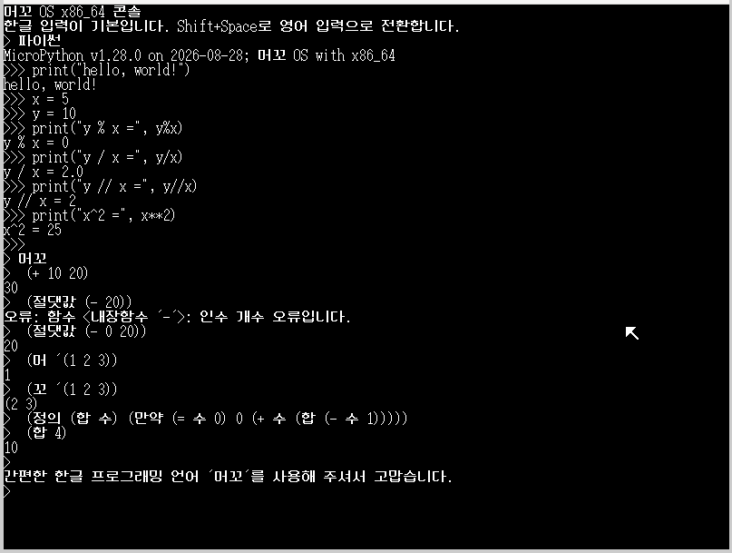
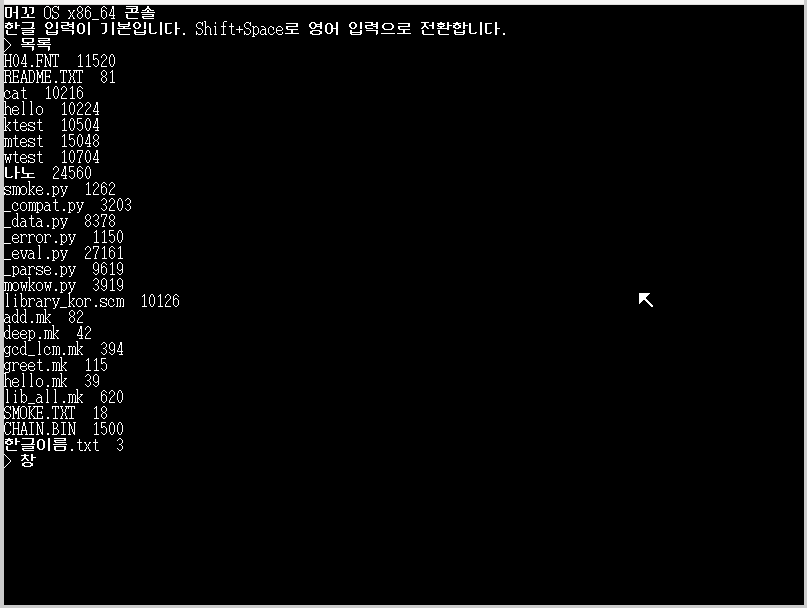
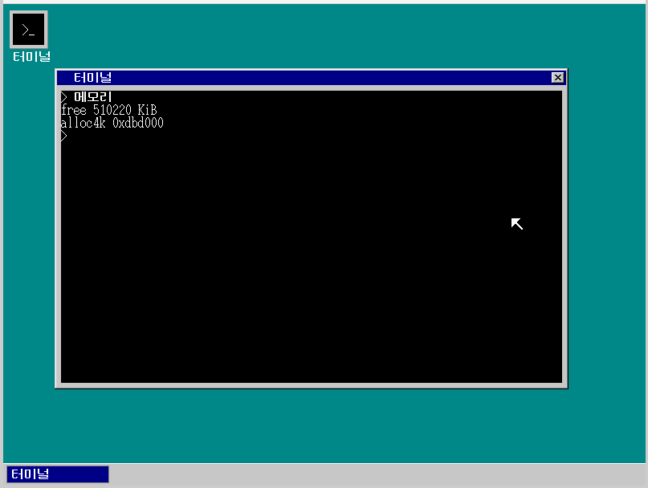
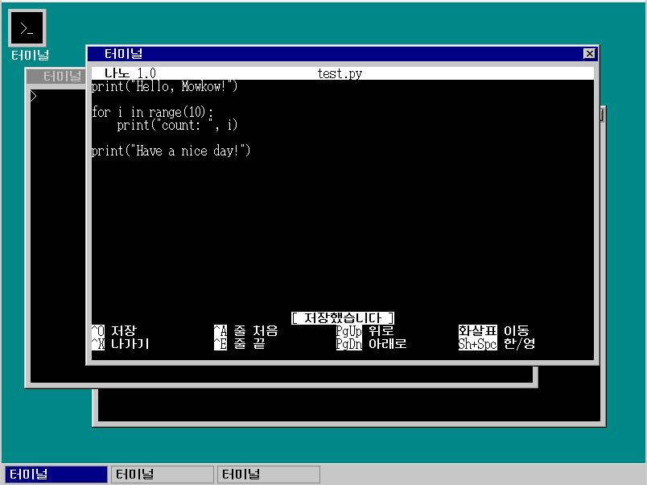
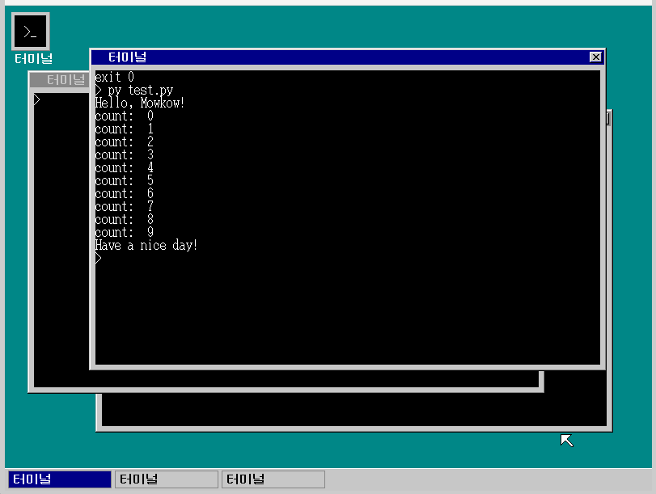
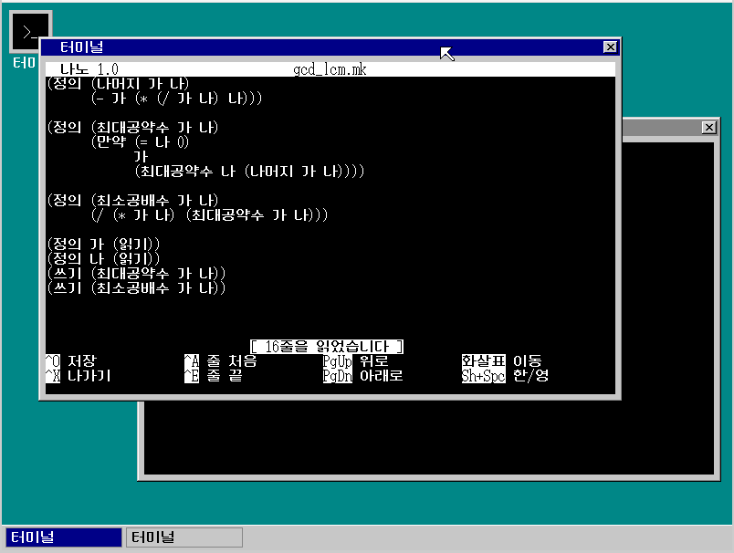
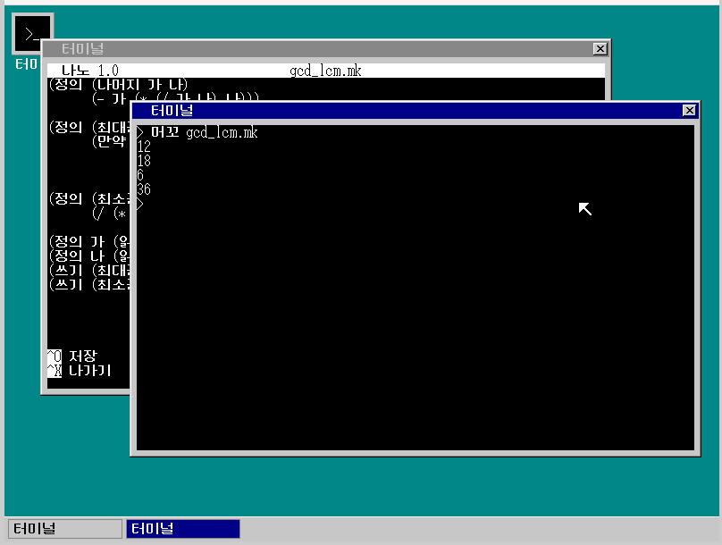

# Mowkow OS 64

x86_64와 Raspberry Pi 5에서 실행하는 교육용 한글 운영체제입니다.
두벌식 한글 입력, FAT32/VFAT, 다중 콘솔 GUI, ELF64 앱, 나노 편집기와
커널 내장 MicroPython·한글 LISP 머꼬를 제공합니다.

『OS 구조와 원리』기반 커널에 한글 입력기와 부산대학교 우균 교수님이
개발한 머꼬 인터프리터를 결합한 [Mowkow OS](https://github.com/yonghun8343/Mowkow-OS) 32bit 구현을 바탕으로, 표준 크로스 툴체인과 실제 블록 I/O를 사용하는 64bit 커널로 확장했습니다.

## 문서

실행할 플랫폼의 문서에서 준비물부터 부팅·문제 해결까지 순서대로 확인할 수 있습니다.

| 문서 | 내용 |
|-|-|
| [x86_64](docs/platforms/x86_64.md) | GNU 툴체인, QEMU IDE/AHCI 실행, BIOS 부팅, 메모리·장치·ABI |
| [Raspberry Pi 5](docs/platforms/raspberry-pi-5.md) | AArch64 빌드, SD 카드 부트 파일, EL1/MMU, SDHCI·RP1·USB·ABI |
| [공통 시스템 구조](docs/architecture.md) | 모듈 책임, 콘솔·GUI·FAT32·프로세스·MicroPython, 빌드·검증, 소스 트리 |

### 이 README에서 확인할 수 있는 내용 

* [실행 화면](#실행-화면) 
* [명령어](#명령어) 
* [진행 상황](#진행-상황)

### 지원 대상

| 대상 | 빌드 명령 | 산출물 | 실행 문서 |
|-|-|-|-|
| x86_64 / QEMU | `make x86_64` | `img64/mowkow64.img` (FAT32 64MiB) | [IDE·AHCI 실행](docs/platforms/x86_64.md#빌드와-실행) |
| Raspberry Pi 5 / AArch64 | `make aarch64` | `build64/aarch64-boot/` (부트 파티션에 복사할 파일 묶음) | [SD 카드 부팅](docs/platforms/raspberry-pi-5.md#sd-카드-준비와-부팅) |
| 32bit 참조 구현 | `make` | `img/haribote.img` (FAT12 플로피) | `make run`, `make iso` |

`32bit/`는 교재 도구를 사용하는 독립된 참조 트리이고, 현재 개발 대상은
`64bit/`의 공용 코드와 두 플랫폼 백엔드입니다. 기본 `make`는 32bit를 빌드합니다.
전체 목표는 `make help`로 확인합니다.

### 공통 개발 검사

저장소 루트에서 실행합니다. 두 크로스 툴체인이 필요합니다.

```bash
make check64       # 스타일 + 호스트 테스트 + 양 아키텍처 증분 빌드
```

세부 검사와 범위는 [빌드와 검증](docs/architecture.md#빌드와-검증)을 참고하세요.
QEMU 회귀와 Pi 5 실기 검증은 별도입니다.

## 실행 화면

### 파이썬 REPL, 머꼬 REPL



### CLI - GUI 전환

<p align="center">
    
    
</p>

### 나노 에디터를 활용한 파이썬 코딩 및 실행

<p align="center">
    
    
</p>

### 나노 에디터를 활용한 머꼬 코딩 및 실행

<p align="center">
    
    
</p>

## 명령어

플랫폼별 부팅이 끝난 뒤 사용하는 공통 콘솔 명령입니다.

### 애플리케이션 실행

애플리케이션 이름만 입력하면 실행됩니다.

```bash
# 예) 나노 편집기 열기
> 나노

# 예) 나노 편집기로 텍스트 파일 열기
> 나노 README.TXT

# 예) 파일 내용 보기
> cat readme.txt
```

`나노`는 GNU nano 9.3 코어를 사용합니다. `Ctrl+O`로 저장, `Ctrl+X`로 종료,
`Ctrl+W`로 검색, `Ctrl+\`로 바꾸기, `Alt+U`/`Alt+E`로 실행 취소/재실행합니다.
한/영 전환은 기존 키를 사용하며 열기와 저장은 64KiB까지 지원합니다.

### CLI-GUI 전환

```bash
# 한글 명령어
> 창

# 영어 명령어
> window
```

화면 출력 모드를 변경합니다.
GUI 모드에서는 마우스로 제목 표시줄을 끌어 창을 옮기거나, 창을 클릭해 활성 창을 바꿀 수 있습니다.
전체 화면 토글은 부팅 콘솔(콘솔 0)에서만 동작합니다.

```bash
# 콘솔 하나 더 띄우기 (최대 4개)
> 새창
> new
```

숨긴 콘솔은 자기 태스크에서 계속 실행됩니다. 닫기 버튼은 종료를 요청하며,
실행 중인 앱이나 인터프리터가 끝나 프롬프트로 돌아오면 태스크와 창을 정리합니다.
바탕화면 아이콘으로도 새 콘솔을 띄울 수 있고, 작업 표시줄에서 숨긴 콘솔을 되살릴 수 있습니다.

### 파이썬

```bash
# REPL 시작 (Ctrl-D로 나감)
> py

# 파일 실행
> py TEST.PY
```

### 머꼬

```bash
# REPL 시작 (빈 줄, Ctrl-C, Ctrl-D 중 아무거나로 나감)
> 머꼬

# 파일 실행
> 머꼬 hello.mk
```

```
> 머꼬
>  (정의 (제곱 수) (* 수 수))
>  (제곱 12)
144
>  0육ㄱ
10
>
간편한 한글 프로그래밍 언어 '머꼬'를 사용해 주셔서 고맙습니다.
```

커널 콘솔과 같은 명령줄 인터페이스를 사용하므로 동일하게 한글을 입력할 수 있습니다.
머꼬 실행 환경을 한 번 만든 뒤로는 `library_kor.scm`을 다시 읽지 않으므로 두 번째부터는 바로 뜹니다.

### 기타 명령어

```bash
> help
> 목록 / ls # 파일 목록
> 메모리 / mem # 남은 메모리
> 지우기 / clear # 화면 지우기
> 태스크 / tasks # 태스크 전환 횟수
> ticks # 타이머 틱
> 읽기 / type # 파일 내용 보기
> 실행 / run # 실행 파일 실행 (예: run HELLO)
```

## 진행 상황

| 항목 | 상태 |
|-|-|
| x86_64 롱 모드 / Pi 5 AArch64 EL1 부팅 | ✅ |
| FAT32 읽기/쓰기 | ✅ |
| 한글 콘솔 (두벌식, UTF-8) | ✅ |
| 시트/창 컴포지터, 창 전환 | ✅ |
| 다중 콘솔 (콘솔당 태스크, 작업 표시줄) | ✅ |
| ELF64 유저 프로세스, 사용자 모드 진입, 시스템 콜 | ✅ |
| 커널 내장 MicroPython | ✅ |
| 나노 편집기 | ✅ |
| 머꼬 인터프리터 (MicroPython 위에서) | ✅ |
| 프로세스별 주소 공간 (페이징 격리) | ❌ |
| 앱 동시 실행 | ❌ |

## 사용할 때

- 모든 파일은 FAT32 루트에 위치하며 하위 디렉터리는 지원하지 않습니다.
- 나노로 저장한 파일은 실행 중인 디스크 이미지나 SD 카드에 남습니다.
  매체·이미지를 새로 만들거나 덮어쓰면 저장 파일이 사라질 수 있습니다.
- ELF 앱은 시스템 전체에서 하나, MicroPython·머꼬는 단일 VM 세션 하나만 실행할 수 있습니다.
- 프로세스별 페이지 테이블 격리는 제공하지 않으므로 신뢰된 내장 앱을 실행하는 모델입니다.

플랫폼별 매체·이미지 주의 사항은 실행 문서에, 메모리·앱·캐시 등의 제약은
[공통 한계](docs/architecture.md#공통-한계)에 정리했습니다.
