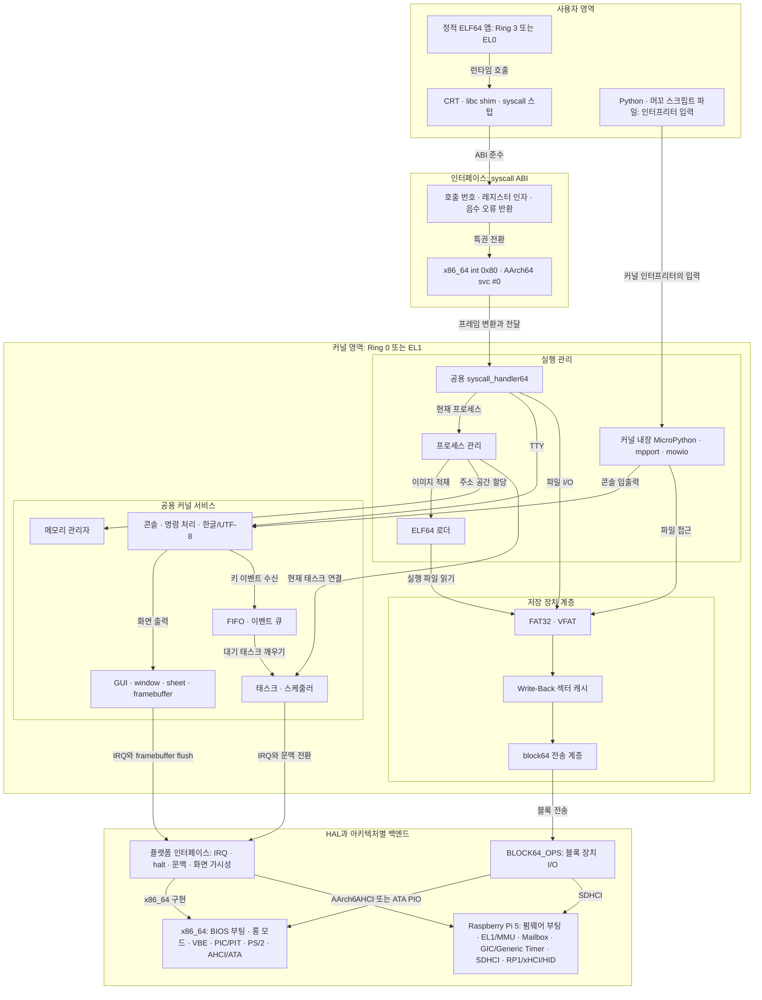

# 공통 시스템 구조

[프로젝트 소개](../README.md) · [x86_64](platforms/x86_64.md) · [Raspberry Pi 5](platforms/raspberry-pi-5.md)

두 64bit 포트가 공유하는 커널·앱·인터프리터의 책임과 인터페이스를 설명합니다.
부팅, 주소 매핑, syscall 레지스터, 장치와 실행 절차는 각 플랫폼 문서에 있습니다.
셸 명령은 저장소 루트에서 실행합니다. 커널 소스의 짧은 경로는
`64bit/src64/` 기준이며, 빌드·앱·도구 경로는 저장소 루트 기준입니다.

- [아키텍처 개요](#아키텍처-개요)
- [메모리와 태스크](#메모리와-태스크)
- [프로세스와 syscall](#프로세스와-syscall)
- [저장 장치 계층](#저장-장치-계층)
- [GUI와 다중 콘솔](#gui와-다중-콘솔)
- [머꼬 인터프리터](#머꼬-인터프리터)
- [빌드와 검증](#빌드와-검증)
- [프로젝트 디렉터리](#프로젝트-디렉터리)
- [공통 한계](#공통-한계)

## 아키텍처 개요

32bit 참조 구현은 교재 툴체인, TSS 하드웨어 전환, LDT 세그먼트 보호와
FAT12 RAM 디스크를 사용합니다. 64bit 트리는 이를 표준 크로스 툴체인,
소프트웨어 문맥 관리, 정적 ELF64와 실제 블록 I/O로 확장했습니다.
현재 syscall 포인터 검사는 LDT 보호와 같은 수준의 앱 격리를 제공하지 않습니다.

| 영역 | 32bit 참조 | 공용 64bit 구현 |
|-|-|-|
| 소스 | `32bit/src/`, `32bit/app/` | `64bit/src64/`, `64bit/app64/` |
| 앱 형식 | 교재 `.hrb` (Hari 시그니처) | 정적 ELF64 (`ET_EXEC`, `PT_LOAD`) |
| 저장 장치 | 플로피 FAT12, 전체 이미지를 RAM에 상주 | FAT32/VFAT, 캐시를 거친 블록 I/O |
| 태스크 | TSS 하드웨어 전환 | 공용 run queue와 플랫폼별 소프트웨어 문맥 전환 |
| 스크립트 | C로 다시 쓴 머꼬 | 커널에 링크된 MicroPython v1.28 위에서 파이썬 머꼬 실행 |

64bit 트리는 사용자 영역, 시스템 콜 인터페이스, 공용 커널, HAL로 계층을
나눕니다. ELF64 앱은 사용자 모드에서 시스템 콜로 커널에 진입하지만,
MicroPython은 커널에 링크되어 Python과 머꼬 스크립트를 커널 모드에서
실행합니다.



화살표는 상위 계층이 하위 계층을 호출하거나 의존하는 방향을 나타냅니다.
스크립트 파일은 사용자 영역에서 제공되지만 독립 프로세스가 아닙니다. 커널에
내장된 MicroPython이 직접 해석하므로 ELF64 앱과 달리 syscall ABI를 거치지
않습니다. 커널 안에서도 메모리 관리, 태스크 스케줄링, 이벤트 큐와
FAT32·캐시·블록 전송은 각각 독립된 책임과 인터페이스를 가집니다. HAL에서는
`include/arch/platform64.h`와 각 아키텍처의 `platform64.c`가 IRQ 상태 저장·복원,
halt, 태스크 문맥 전환과 프레임버퍼 가시성 처리를 연결합니다. 타이머와 입력
장치는 플랫폼별 초기화 경로에서 공용 이벤트를 만들고, `BLOCK64_OPS`는
저장 장치 전송 차이를 감춥니다.

주요 모듈의 책임은 다음과 같습니다. 아래 소스 경로는 `64bit/src64/` 기준입니다.

| 영역 | 구현과 경계 |
|-|-|
| 콘솔 | 공개 API `include/console64.h`는 `CONSOLE64` 내부 구조를 숨김. 상태와 모듈 간 연결은 `kernel/console_internal64.h`에 한정 |
| 콘솔 수명·입출력 | `kernel/console64.c`는 슬롯·태스크 수명, `console_queue64.c`는 키 FIFO·raw 이벤트 대기 |
| 콘솔 표시·입력·명령 | `kernel/console_render64.c`, `console_editor64.c`, `console_command64.c`로 분리. 한글 조합은 공용 `lib/hangul64.c` 사용 |
| GUI·그리기 | `kernel/gui64.c`의 `GUI_CONTEXT64`가 창·버퍼 소유권 관리. `lib/draw64.c`와 `kernel/framebuffer64.c`가 경계 검사와 출력 형식 담당 |
| FAT32 | `kernel/fd64.c`는 공개 파일 API·mount·동기화, `fd64_fat.c`는 FAT·클러스터, `fd64_dir.c`는 VFAT 이름·디렉터리 순회. 내부 계약은 `fd64_internal.h` |
| 앱 실행 | `kernel/elf64_loader.c`가 이미지 검증·적재, `process64.c`가 스택·힙·파일·종료 수명, `syscall64.c`가 dispatcher와 연산별 helper 담당 |
| MicroPython | `mpport/mpport_main.c`가 단일 VM 세션 수명, `mpport_file64.c`가 파일 소스·reader 소유권, `modmowio.c`가 커널 I/O 모듈 담당 |

## 메모리와 태스크

공용 free-list 할당기 `memory64.c`는 커널 정적 영역과 고정 사용자 이미지 창을
일반 메모리 풀에서 제외합니다. 주소 배치와 매핑 방식은 각 플랫폼 문서에 있습니다.

할당기는 정렬과 주소·크기 overflow, 풀 밖 반환, 중첩·중복 반환을 검사합니다.
free-list 조작은 `platform_irq_save64()`/`platform_irq_restore64()`로 보호하며,
`memman64_validate()`로 정렬·순서·비중첩 조건을 검사할 수 있습니다.

`mtask64.c`는 run queue와 상태 전이를 관리하고, 플랫폼별 문맥 구성·전환 경로를
연결합니다. 레벨 10단, 레벨 안에서 라운드 로빈, 잠든 태스크는 큐에서 제외,
최하위 레벨에 idle 태스크를 두는 정책을 사용합니다.

* `task_kill64` — 닫기 준비를 마친 콘솔을 다른 태스크가 회수할 때 스택을 반납합니다. 현재 태스크 자신은 제거할 수 없습니다.
* `struct TASK64`의 `process`/`is_user`/`kernel_rsp` — 시스템 콜이 현재 실행 중인 프로세스를 태스크에서 찾습니다.
* 상태 검증과 sleep/wake — enum 상태와 IRQ-safe run queue를 사용하고, 대기 준비와 실제 sleep을 나누어 그 사이의 wake를 보존합니다.
* FIFO — put/get은 IRQ-safe하며, 큐 임계 구역을 해제한 뒤 태스크를 깨웁니다. 오버런 횟수도 보존합니다.
* `TASK_STACK_DEBUG64=1` — 태스크 스택의 guard와 최대 사용량 검사를 켭니다. 가드 페이지를 제공하는 기능은 아닙니다.

## 프로세스와 syscall

앱은 freestanding 정적 ELF64이며 hosted libc, 동적 링커, fork/exec가 없습니다.
현재 syscall 경계에서 유저 포인터를 검사하며, 프로세스별 주소 공간 격리는
제공하지 않습니다. 신뢰된 내장 앱을 실행하는 모델입니다.

```c
int process64_user_range_valid(const void *ptr, size_t size)
    // 현재 프로세스의 image / stack / heap 구간 중 하나에 완전히 들어가는가
```

ELF 로더는 빌드 아키텍처에 맞는 `EM_X86_64`/`EM_AARCH64` 정적 `ET_EXEC`만
받습니다. header·segment 범위, 정렬, 겹침을 검사하고, 최소 한 개의 `PT_LOAD`와
실행 가능한 segment 안의 entry를 요구합니다. 고정 이미지 창의 소유자는
하나이므로 ELF 앱은 시스템 전체에서 한 번에 하나만 실행할 수 있습니다.

syscall 번호와 연산 의미는 두 플랫폼에서 공유합니다. 진입 명령·레지스터 규약은
[x86_64 ABI](platforms/x86_64.md#태스크와-사용자-모드-진입)와
[Pi 5 ABI](platforms/raspberry-pi-5.md#사용자-모드와-syscall)에 있습니다.

| 번호 | 이름 | 비고 |
|-|-|-|
| 1 | `SYS_EXIT` | 종료 상태를 기록하고 저장된 커널 스택으로 복귀 |
| 2 / 3 | `SYS_WRITE` / `SYS_READ` | fd 0·1·2는 프로세스를 띄운 콘솔, 3 이상은 파일 |
| 4 / 5 / 6 | `SYS_OPEN` / `CLOSE` / `SEEK` | `O_CREAT`, `O_TRUNC` 플래그. 별도 CREATE 없음 |
| 7 / 8 | `SYS_ALLOC` / `SYS_FREE` | 프로세스 힙의 bump 할당. FREE는 범위 검증만 함 |
| 9 | `SYS_TICKS` | 타이머 틱 (100Hz) |
| 10 | `SYS_TTY` | 첫 인자에 연산 코드를 실은 다중화 콜 |

유저 예외는 해당 프로세스를 종료하고 콘솔로 복귀하며, 커널 예외는 진단 후 정지합니다.

`syscall64.c`는 사용자 문자열을 길이 제한이 있는 커널 버퍼에 복사한 뒤
파일시스템에 전달합니다. 명령행·인수 개수와 파일명 UTF-8도 검증하며, 종료 시
raw TTY, 열린 파일, 이미지 소유권, 스택·힙과 사용자 매핑을 정리합니다.

앱 CRT는 `syscall.c`의 공용 wrapper와 `syscall_arch64.c`의 아키텍처별 호출로
나뉩니다. `read`/`write`는 부분 전송과 음수 오류를 그대로 반환하고, `puts`는
부분 쓰기를 재시도하며 오류를 전파합니다. CRT `malloc/free`는 bump 힙 안에서
16바이트 정렬 블록을 재사용·병합하고, 메타데이터 손상 시 할당기 변경을 중단합니다.

나노는 길이를 받는 UTF-8 decoder로 커서 이동·삭제와 표시 경계를 맞추고,
잘못된 바이트는 원본을 보존하며 U+FFFD로 표시합니다. 파일은 64KiB까지 읽고,
저장할 전체 크기를 truncate 전에 검사합니다. 저장 중 부분 쓰기는 재시도하고,
쓰기나 close 실패 시 수정 상태를 유지합니다. 저장 자체는 in-place 방식입니다.

`SYS_TTY`는 나노 같은 전체 화면 편집기를 위한 raw 모드(줄 편집과 에코 끄기)를 제공합니다. `TTY_READKEY`가 돌려주는 64비트 값에 한글 조합 중 상태가 함께 실립니다.

## 저장 장치 계층

```
fd64.c 공개 파일 API·mount·동기화
    ├ fd64_fat.c FAT/클러스터 관리
    └ fd64_dir.c VFAT 이름·디렉터리 순회
    ↓
cache64.c 되쓰기 섹터 캐시 (4KiB 블록, 4MiB)
    ↓
block64.c 전송 계층 고르기 + 파티션 시작 위치
    ↓
BLOCK64_OPS를 구현한 플랫폼별 전송 드라이버
```

전송 계층을 추가하고 싶다면 `struct BLOCK64_OPS`만 채우면 됩니다.
그 위 계층은 손대지 않아도 됩니다.

파일시스템 공개 API는 태스크 문맥에서만 호출하며, sleepable mutex로 전체
연산을 직렬화합니다. 호출 순서는 `fd64 mutex → cache64 → block64`이고,
캐시 내부 포인터도 이 연산 범위 안에서만 사용합니다.

mount 전에 BPB와 볼륨 geometry를 검증하고, FAT chain은 클러스터 수로 순회를
제한하며 cycle을 검출합니다. 저장 순서는 데이터 → FAT → 디렉터리입니다.
쓰기 실패 시 dirty 캐시를 보존하고 중간 할당을 가능한 범위에서 되돌리며,
복구할 수 없는 동기화 실패 시 볼륨을 읽기 전용으로 전환합니다.

## GUI와 다중 콘솔

시트 합성기(`sheet64.c`)는 8bpp 버퍼를 합성합니다. 시트 등록 시 버퍼 용량과
행 stride를 전달하고, window·글꼴 그리기는 `SURFACE64`의 크기와 clip을
검사합니다. 음수 좌표와 폭·높이 계산도 쓰기 전에 검증합니다.

`framebuffer64.c`는 출력 버퍼의 pitch·해상도·용량을 검증한 `FRAMEBUFFER64`를
유지합니다. 출력 형식은 backend로 분리하고, 갱신 범위를 clipping한 뒤
플랫폼별 cache clean·가시성 barrier를 수행합니다. 시트·surface clip의 끝 좌표는 exclusive, 사각형 채우기는 inclusive입니다.

다중 콘솔을 지원하기 위해 콘솔의 상태를 `struct CONSOLE64`에 저장하고, 콘솔마다 태스크, 256KiB 스택, 키 FIFO를 둡니다. 콘솔은 한 번에 최대 4개 띄울 수 있습니다.

* 숨긴 콘솔도 계속 실행되고, GUI는 반응합니다.
* 바탕화면 아이콘이 새 콘솔을 띄우고, 작업 표시줄이 숨긴 콘솔을 되살립니다.
* 전체 화면 토글(`창`/`window`)은 콘솔 0 전용입니다. 화면 크기 버퍼가 있는 콘솔이 0번뿐이기 때문입니다.

키 입력은 포커스가 있는 콘솔의 태스크로 전달하며, 콘솔이 아닌 창이 활성이면
전달하지 않습니다. 플랫폼별 입력 생산 경로는 각 플랫폼 문서에서 설명합니다.

`gui64.c`의 `GUI_CONTEXT64`가 창, 포커스, 드래그, 화면 버퍼와 지연 해제
목록을 관리합니다. 창 생성은 준비 → 태스크 시작 → 공개 순서로 진행하며,
실패하면 획득한 자원을 정리합니다. 렌더러 참조가 남은 버퍼는 resize·close로
무효화하지 않고, 해제 실패는 소유권을 유지한 채 재시도합니다.

닫기 버튼은 요청만 남깁니다. 콘솔 태스크가 명령 실행을 마쳐 안전한 지점에
도달하면 `close_ready`를 표시하고 대기하며, 메인 루프의
`console64_reap_closed()`가 태스크·창을 회수합니다. teardown이 완료된 뒤에만
콘솔 슬롯을 재사용합니다.

GUI 수명 변경은 IRQ 상태를 저장·복원하는 짧은 트랜잭션으로 보호하고 그 안에서
sleep하지 않습니다. 락 순서는 GUI/lifecycle → sheet/FIFO/task/memory입니다.
파일시스템의 sleepable mutex는 별도 경로에서 사용합니다.

콘솔의 raw 입력은 raw 이벤트 링과 키 FIFO를 한 IRQ-save 구간에서 확인한 뒤
대기합니다. 크기 변경은 `TTY_SIZE`의 generation과 raw `RESIZE` 이벤트로
알리므로, 키보드 입력 없이 resize만 발생한 경우에도 앱을 깨울 수 있습니다.

## 머꼬 인터프리터

64bit 머꼬 OS는 원본 파이썬 소스를 커널에 링크된 MicroPython에서 실행합니다.

```
콘솔: 머꼬 [파일]
  └ mpport_run_mowkow()          "import mowkow; mowkow.main()"을 컴파일
      └ mowkow.py                진입점 (업스트림 main.py 대신)
          ├ base_env()           내장 함수 + library_kor.scm, 부팅마다 한 번
          └ mkenv(base_env())    세션마다 새 틀
              └ _parse/_eval/_data/_error    업스트림 소스 (1093줄)
                  └ _compat.py   MicroPython에 없는 CPython 동작만 되살림
                      └ mowio    커널로 나가는 창구 (C, modmowio.c)
```

업스트림([woogyun/mowkow](https://github.com/woogyun/mowkow), 커밋 `1dae112`)은 `64bit/py64/머꼬/upstream/`에 그대로 두고, 실제 실행되는 사본은 `64bit/py64/머꼬/`에 두었습니다.
둘의 차이는 의존성 계층뿐이며 파서와 계산기는 건드리지 않았습니다.

네 파일에서 바뀐 줄은 38줄이며, `diff -r 64bit/py64/머꼬/upstream 64bit/py64/머꼬`로 확인할 수 있습니다.

`mowio`는 표준 라이브러리 대신 커널을 부르는 코드입니다.

| `mowio` | 대신하는 것 | 이유 |
|-|-|-|
| `readline(프롬프트)` | `input()` | MicroPython의 입력은 바이트 단위라 3바이트 음절을 백스페이스로 깨뜨립니다. 콘솔의 명령 줄 인터페이스를 그대로 호출하여 실시간 조합도 적용합니다. |
| `readfile(경로)` | `io.open()` | POSIX 파일이 없습니다. `fd64`로 읽고 UTF-8을 검사합니다. |
| `argv()` | `sys.argv` | 문자열 파싱만을 위해 sys 라이브러리를 가져오기에는 비용이 너무 큽니다. |
| `ticks()` | `time` | 시작 시간 측정에만 씁니다. |

`_compat.py`에는 업스트림 소스가 쓰는 것 중 MicroPython에 없는 것을 채우는 shim 코드 여섯 개가 있습니다.

머꼬를 쓰려면 먼저 `library_kor.scm` 252줄을 계산해서 기본 함수들(`머리`, `거꾸로`, `맵` 등)을 환경에 채워 넣어야 합니다. 이 준비에 1.4초가 걸립니다.

명령이 끝날 때마다 MicroPython을 정리하면 `머꼬`를 부를 때마다 준비 시간 1.4초가 걸리므로 정리(`mp_deinit()`)하지 않고 해석기를 부팅 내내 켜 둡니다. 준비된 환경이 파이썬 모듈 안에 그대로 남아 있기 때문에, 첫 `머꼬` 실행에만 1.4초가 걸리고 두 번째 실행부터는 곧바로 실행됩니다.

세션마다 그 환경 위에 새 환경을 하나 덮어쓰기 때문에 앞 세션에서 만든 정의는 다음 세션에 보이지 않지만, 라이브러리는 다시 계산하지 않고 물려받습니다.

Python REPL, 파일 실행, 머꼬 진입은 `mpport_main.c`의 공용 세션 경로를
사용합니다. IRQ-save claim으로 단일 VM을 점유하고, NLR 예외 처리 구간에서
초기화·실행·오류 보고를 마친 뒤 공통 cleanup에서 REPL·인수 상태와 점유를
해제합니다. 첫 초기화 실패는 VM·GC 상태를 되돌리며, 성공한 VM은 유지합니다.

파일 소스와 lexer reader의 수명은 `mpport_file64.c`에서 관리합니다.
정확한 크기를 읽지 못하면 소스를 해제하고 EIO 예외를 발생시키며, lexer 생성
중 예외나 `mowio.readfile()`의 문자열 복사 실패도 NLR cleanup으로 정리합니다.
MicroPython vendor 소스는 그대로 두고 포트·shim에서 처리합니다.

## 빌드와 검증

Makefile은 공용 목록과 아키텍처별 규칙으로 나뉘어 있습니다.

```
Makefile                   기본 목표, help/info, style·host·QEMU 검사 목표
common/mk/config.mk        디렉터리, 도구, 컴파일 옵션 (공통)
32bit/mk/x86.mk            32bit 빌드 규칙
64bit/mk/common64.mk       두 64bit 아키텍처의 공용 소스·CRT 목록, 앱 자동 발견
64bit/mk/micropython.mk    MicroPython 빌드 규칙
64bit/mk/x86_64.mk         x86_64 커널·앱·FAT32 이미지 빌드 규칙
64bit/mk/aarch64.mk        Pi 5 커널·앱·부트 staging 빌드 규칙
```

공용 커널 소스는 `common64.mk` 한 곳에 등록하고, 각 아키텍처는 플랫폼 소스만
추가합니다. `app64/`의 직계 디렉터리 중 `crt`를 제외한 항목을 앱으로 발견해
두 아키텍처의 빌드 규칙을 생성합니다. 이미지·staging 파일 구성은 각 플랫폼
문서와 해당 Make 규칙에서 관리합니다.

자체 C 코드와 MicroPython vendor 코드는 경고 옵션을 분리합니다. 커널·앱·
mpport는 `-Werror`를 포함한 강화 경고를 적용하고, `mpport_headers64.c`는
자체 포트 헤더도 양쪽 아키텍처에서 직접 컴파일해 검사합니다.

```bash
make style64       # 자체 소스 스타일·금지 API 검사
make test64-host   # Python unittest와 C 호스트 harness 검사
make check64       # style64 + test64-host + x86_64 + aarch64
```

`check64`는 증분 빌드 검사이며 QEMU·Pi 5 실행을 포함하지 않습니다.
빌드 규칙·생성 헤더·링커·아키텍처 경계를 바꾸면 clean build로도 확인합니다.
QEMU IDE/AHCI 회귀는 [x86_64 실행 문서](platforms/x86_64.md#빌드와-실행)의 별도 목표를 사용하고,
Pi 5는 실제 보드에서 확인해야 합니다. 부트 상수·예외 프레임·디스크 배치는
NASM `%if`, C `_Static_assert`, linker `ASSERT`로도 검사합니다.

## 프로젝트 디렉터리

```
.
├── README.md                   # 프로젝트 소개와 사용 안내
├── 📂docs
│   ├── architecture.md         # 공통 시스템 구조·빌드·계약
│   └── 📂platforms
│       ├── x86_64.md           # x86_64 빌드·실행·구현
│       └── raspberry-pi-5.md   # Pi 5 빌드·부팅·구현
├── Makefile                    # 전체 빌드 진입점과 help/info 목표
├── arch.md                     # Raspberry Pi 5 AArch64 포팅 설계와 검증 기록
├── refactor_plan.md            # 단계별 리팩터링 범위·완료 상태·검증 조건
├── 📂common                    # 32/64비트 트리가 함께 쓰는 파일
│   ├── 📂mk                    # config.mk (공용 경로와 도구 설정)
│   └── 📂font                  # H04.FNT, E2.FNT, hankaku 비트맵 글꼴
├── 📂32bit                     # 기존 32비트 보호 모드 트리
│   ├── 📂src                   # boot, kernel, drivers, lib, include
│   ├── 📂app                   # 32비트 HRB 응용 프로그램과 API
│   ├── 📂mk                    # x86.mk 빌드 규칙
│   ├── 📂tools                 # nask, gocc1, obj2bim, bim2hrb, edimg
│   ├── 📂testfiles             # FAT12 이미지에 넣는 시험 파일
│   └── 📂ASM                   # 교재 어셈블리 자료
├── 📂64bit                     # x86_64와 AArch64가 공유하는 64비트 트리
│   ├── 📂mk
│   │   ├── common64.mk         # 공용 소스·CRT 목록과 앱 자동 발견
│   │   ├── x86_64.mk           # x86_64 커널·앱·FAT32 이미지 빌드
│   │   ├── aarch64.mk          # Pi 5 커널·앱·부트 staging 빌드
│   │   └── micropython.mk      # 아키텍처별 MicroPython 생성물과 링크 규칙
│   ├── 📂board/pi5
│   │   ├── config.txt          # Pi 5 펌웨어 부팅 설정
│   │   └── README.md           # bring-up 단계, panic code, 실기 검증 기록
│   ├── 📂tools
│   │   ├── mkfat32_64.py       # x86_64 FAT32 디스크 이미지 생성
│   │   ├── stage_aarch64_boot.py # Pi 5 부트 파티션 파일 묶음 생성
│   │   ├── mowkow_parity.py    # 머꼬 CPython 병행 검사
│   │   ├── app_regression64.py # 복제 이미지의 IDE/AHCI 앱·재부팅 회귀 검사
│   │   └── check_style64.py    # 자체 코드 스타일·금지 API 검사
│   ├── 📂tests                # unittest, C 호스트 harness, 실패 주입·상태 전이 검사
│   ├── 📂src64                 # 공용 64비트 커널과 아키텍처 백엔드
│   │   ├── 📂boot              # x86_64 1·2단계 부트로더
│   │   ├── 📂arch/x86_64       # platform64, 부트 진단·글꼴, 자체 점검
│   │   ├── 📂arch/aarch64      # EL1 진입, MMU/GIC/타이머, SDHCI, RP1/xHCI/HID
│   │   ├── 📂drivers           # x86_64 장치 드라이버와 공용 block/graphic 계층
│   │   ├── 📂kernel            # 분리된 console/FAT32, cache, task/mutex, GUI/framebuffer, process/syscall
│   │   ├── 📂lib               # Hangul, UTF-8, FIFO, keymap, 문자열
│   │   ├── 📂mpport            # MicroPython 포트와 아키텍처별 최소 libc/math
│   │   └── 📂include
│   │       └── 📂arch          # 공용 아키텍처 HAL과 exception frame 계약
│   ├── 📂app64                 # 두 아키텍처용 정적 ELF64 응용 프로그램
│   │   ├── 📂crt               # x86_64/AArch64 crt0, syscall, 문자열, malloc
│   │   ├── 📂hello             # 최소 실행 예제
│   │   ├── 📂cat               # 파일 내용 출력
│   │   ├── 📂ktest             # raw 키 입력 점검
│   │   ├── 📂mtest             # 사용자 heap 점검
│   │   ├── 📂wtest             # FAT32 쓰기 점검
│   │   └── 📂나노              # 나노 편집기 포트
│   └── 📂py64
│       ├── smoke.py            # MicroPython 통합 점검
│       ├── float_smoke.py      # AArch64 double/수학 연산 점검
│       └── 📂머꼬              # 인터프리터, 라이브러리, 예제와 upstream 원본
├── 📂screenshots               # README 실행 화면 이미지
└── 📂third_party
    └── 📂micropython           # 업스트림 MicroPython 서브모듈
```

`build/`, `build64/`, `img/`, `img64/`는 빌드 때 생기는 생성물이므로 위 트리에서
제외했습니다.

## 공통 한계

| 한계 | 위치 | 결과 |
|-|-|-|
| 프로세스별 주소 공간 격리 없음 | 전체 | syscall 포인터 검사는 앱의 직접 접근을 차단하지 못함. 신뢰된 내장 앱만 대상. 구체적인 매핑은 플랫폼별 문서 참조 |
| 이미지 창 소유자 하나 | `elf64_loader.c` | 앱은 시스템 전체에서 한 번에 하나만. 두 번째 요청은 거절 |
| 스택 가드 페이지 없음 | `process64.c` | 재귀가 깊은 프로그램이 유저 스택 64KiB를 넘겨 힙을 침범할 수 있음 |
| `SYS_FREE`가 실제로 반환하지 않음 | `syscall64.c` | 힙은 bump 할당. 범위 검증만 수행 |
| 캐시가 직접 매핑 | `cache64.c` | 충돌 시 즉시 축출. FAT은 낮은 LBA, 데이터는 높은 LBA라 실제 충돌은 드묾 |
| MicroPython 단일 인스턴스 | `mpport/` | GC 힙과 상태가 전역 하나. 콘솔마다 파이썬이나 머꼬를 돌릴 수 없고, 두 번째 요청은 거절됨 |
| 자동 검사 범위 제한 | 양쪽 트리 | 64비트는 `make test64-host`와 IDE/AHCI의 머꼬·ktest/mtest/wtest 회귀 검사가 있습니다. 모든 앱·장치나 Pi 5 실행을 포괄하지는 않습니다. 32비트는 수동 검사입니다. |
| 머꼬가 느림 | `64bit/py64/` | 파이썬으로 쓴 트리 워커를 바이트코드 VM 위에서 돌림. 대화형으로는 괜찮지만 긴 스크립트는 눈에 띄게 느려짐 |
