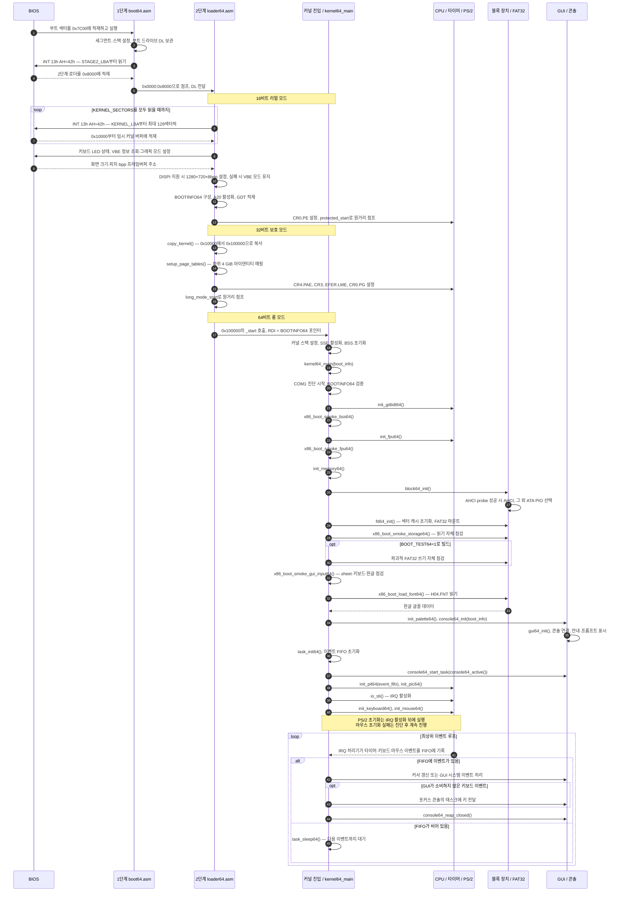
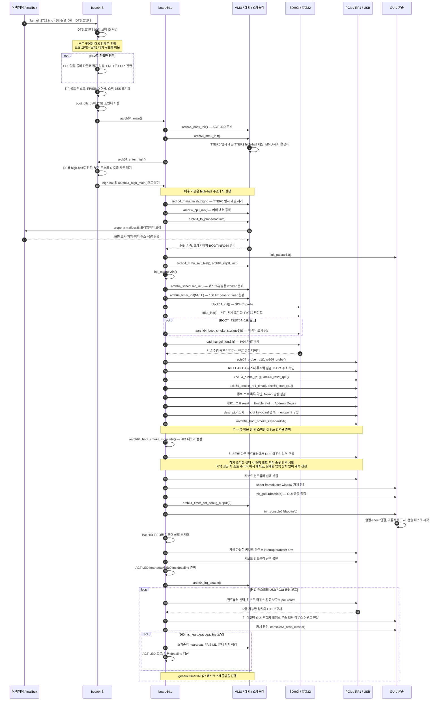

# 64비트 부트 프로세스

`64bit/src64/`의 구현을 기준으로, 펌웨어 진입부터 콘솔 입력을 처리하는
이벤트 루프까지 나타낸다. 참여자는 관련 모듈을 묶은 것이며, 화살표의 함수명은
실제 초기화 진입점을 가리킨다. 별도 태스크의 실행 시점은 스케줄러에 따라 달라진다.

## x86_64 — BIOS / QEMU

BIOS가 부트 섹터를 실행하면 1단계 로더가 2단계 로더를 읽는다.
2단계 로더는 FAT32 예약 영역의 커널 바이너리를 직접 읽고, 보호 모드에서
커널을 1 MiB로 복사한 뒤 롱 모드로 진입한다.

BIOS 디스크 읽기 실패는 오류를 출력하고 정지한다. 필수 커널 초기화 실패는
`x86_boot_panic64()`로 단계와 오류를 기록하고 정지한다.
`console64_init()`은 GUI 생성이 실패하면 프레임버퍼 직접 출력으로 진행한다.

## AArch64 — Raspberry Pi 5

Pi 펌웨어가 `kernel_2712.img`를 물리 주소 `0x80000`에 적재한다.
커널은 EL1과 초기 MMU 매핑을 준비한 뒤 스택과 실행 주소를 TTBR1의
high-half 매핑으로 옮겨 보드 초기화를 이어간다.

예상하지 않은 진입 EL이나 필수 플랫폼 초기화 실패는 ACT LED panic 점멸로
정지한다. USB 키보드·마우스의 장치별 실패는 해당 입력 경로를 비활성화하고
GUI·heartbeat와 정상 입력 장치의 처리를 이어간다.
타이머 설정과 IRQ 활성화는 서로 다른 단계이며, live USB 처리는 IRQ가 아닌
보드의 단일 태스크에서 폴링한다.

## 구현 위치

| 구간 | 소스 |
| --- | --- |
| x86 BIOS 1·2단계 로더 | [boot64.asm](../../64bit/src64/boot/boot64.asm), [loader64.asm](../../64bit/src64/boot/loader64.asm) |
| x86 커널 진입·초기화·이벤트 루프 | [asmfunc64.asm](../../64bit/src64/kernel/asmfunc64.asm), [kernel64.c](../../64bit/src64/kernel/kernel64.c) |
| x86 진단·부트 자체 점검 | [boot_diag64.c](../../64bit/src64/arch/x86_64/boot_diag64.c), [boot_smoke64.c](../../64bit/src64/arch/x86_64/boot_smoke64.c) |
| Pi 진입·high-half 전환·보드 초기화 | [boot64.S](../../64bit/src64/arch/aarch64/boot64.S), [board64.c](../../64bit/src64/arch/aarch64/board64.c) |
| Pi MMU·스케줄러·타이머·부트 자체 점검 | [mmu64.c](../../64bit/src64/arch/aarch64/mmu64.c), [sched64.c](../../64bit/src64/arch/aarch64/sched64.c), [gtimer64.c](../../64bit/src64/arch/aarch64/gtimer64.c), [boot_smoke64.c](../../64bit/src64/arch/aarch64/boot_smoke64.c) |
| 공통 저장 장치·파일시스템 | [block64.c](../../64bit/src64/drivers/block64.c), [cache64.c](../../64bit/src64/kernel/cache64.c), [fd64.c](../../64bit/src64/kernel/fd64.c) |
| 공통 GUI·콘솔 초기화·태스크 | [gui64.c](../../64bit/src64/kernel/gui64.c), [console64.c](../../64bit/src64/kernel/console64.c) |

파괴적 저장 장치 점검은 두 포트 모두 `BOOT_TEST64=1`
(`MOWKOW64_BOOT_TESTS=1`) 빌드에서만 실행한다.
