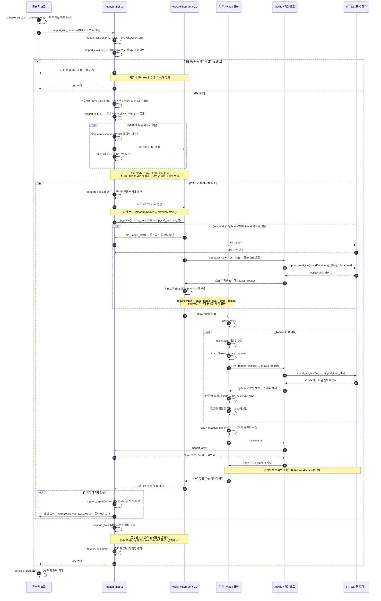
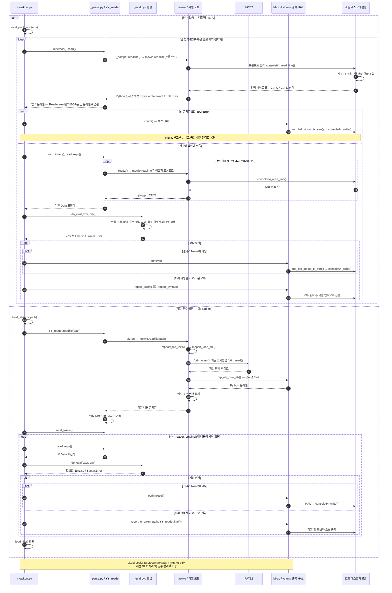

# 머꼬 실행환경

64비트 머꼬는 콘솔 태스크에서 커널에 링크된 MicroPython VM을 통해 실행된다.
`머꼬`는 대화형 REPL, `머꼬 add.mk`는 파일 실행으로 진입한다.
x86_64와 AArch64는 아래 실행 경로를 공유하며, 저장 장치와 키 입력의
플랫폼별 차이는 커널 인터페이스 뒤에서 처리한다.

MicroPython은 머꼬를 구현한 Python 모듈을 바이트코드로 실행하고,
머꼬의 `_parse.py`와 `_eval.py`가 머꼬 표현식을 읽고 평가한다.
`mowio`와 MicroPython HAL은 콘솔·파일시스템으로 이어지는 C 구현이다.

## 세션 진입과 환경 수명

VM의 첫 초기화와 머꼬 기본 환경의 첫 생성은 별도 조건이다.
앞서 `py` 명령으로 VM이 초기화되었어도, 머꼬를 처음 실행하면
`library_kor.scm`을 평가하여 기본 환경을 만든다.

`mp_busy`는 실행·예외 출력·정리 전체를 직렬화한다. IRQ를 끈 상태는
점유 플래그를 변경하는 짧은 구간에 한정되며, 다른 태스크와 GUI는 계속 동작한다.
현재 세션의 환경은 기본 환경을 부모로 참조한다. 다음 실행은 새 환경을 만들므로
이전 세션에서 추가한 정의를 그대로 이어받지 않는다.

첫 VM 초기화 실패 시에는 부분 초기화 상태를 폐기한다. GC 힙 해제가 실패하면
소유권을 유지하여 재시도 때 재사용한다. 성공한 VM에서 발생한 실행 예외는
세션을 정리한 뒤 VM을 유지한다.

## REPL·파일 입력과 표현식 평가

아래 다이어그램은 `main()`이 세션 환경을 만든 뒤의 흐름이다.
`load_file()`은 기본 라이브러리 적재와 사용자 파일 실행에서 함께 사용한다.

머꼬 REPL의 입력은 `mowio.readline()`으로 콘솔 줄 편집기를 호출한다.
`py` 명령의 MicroPython REPL 입력 큐와는 별도 경로이며, 한글 조합·편집은
호출한 콘솔의 상태를 따른다. 일반 `print()`와 `_compat.eprint()` 출력은
MicroPython HAL을 거쳐 같은 콘솔로 전달된다.

파일 로딩은 전체 크기를 정확히 읽은 뒤 문자열이나 lexer에 넘긴다.
파일 열기 실패는 `ENOENT`, 읽기 크기 불일치는 `EIO` 예외로 전달하며,
문자열·lexer 생성 도중 예외가 발생해도 임시 소스와 reader를 정리한다.

## 구현 위치

| 역할 | 소스 |
| --- | --- |
| 명령 분기·콘솔 줄 편집 | [console_command64.c](../../64bit/src64/kernel/console_command64.c), [console_editor64.c](../../64bit/src64/kernel/console_editor64.c) |
| 단일 VM 점유·초기화·실행·정리 | [mpport_main.c](../../64bit/src64/mpport/mpport_main.c) |
| 파일 버퍼·lexer·문자열 소유권 | [mpport_file64.c](../../64bit/src64/mpport/mpport_file64.c) |
| 콘솔·파일·인수 연결, 표준 출력 HAL | [modmowio.c](../../64bit/src64/mpport/modmowio.c), [mphalport.c](../../64bit/src64/mpport/mphalport.c) |
| 머꼬 진입점·기본 환경·REPL·파일 실행 | [mowkow.py](../../64bit/py64/머꼬/mowkow.py) |
| 표현식 파싱·평가·데이터·오류 | [_parse.py](../../64bit/py64/머꼬/_parse.py), [_eval.py](../../64bit/py64/머꼬/_eval.py), [_data.py](../../64bit/py64/머꼬/_data.py), [_error.py](../../64bit/py64/머꼬/_error.py) |
| MicroPython 호환 함수·머꼬 기본 라이브러리 | [_compat.py](../../64bit/py64/머꼬/_compat.py), [library_kor.scm](../../64bit/py64/머꼬/library_kor.scm) |
| 플랫폼별 Python·머꼬 파일 배치 | [x86_64.mk](../../64bit/mk/x86_64.mk), [aarch64.mk](../../64bit/mk/aarch64.mk) |

실제 실행 모듈은 `64bit/py64/머꼬/`의 사본이다. 빌드는 이 파일들을
FAT32 루트에 평평하게 배치하며, `upstream/`은 동작 비교용 참조로 유지한다.
